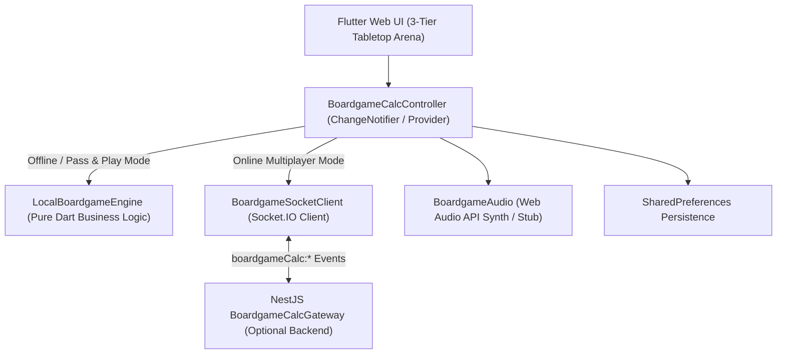

# Boardgame Calculator (`boardgame-calc`) Flutter Architecture

## 1. Overview
`boardgame-calc`는 원본 `pickban_smulator`의 보드게임 계산기 모듈을 **Flutter Web (3.50 / Dart 3.14)** 기반으로 이식·확장한 웹 애플리케이션입니다.
단일 **Warm Walnut & Parchment Gold** 테이블탑 테마를 사용하며, 하나의 컨트롤러(`BoardgameCalcController`) 아래에서 **오프라인/Pass & Play 로컬 엔진**과 **온라인 Socket.IO 실시간 멀티플레이**를 모두 지원합니다.

## 2. Layered Architecture

## 3. Directory Structure

- `lib/main.dart`: 앱 진입점(`BoardgameCalcApp`) 및 3단 테이블탑 아레나(상단 플레이어 현황 · 중앙 보드판 · 하단 내 정보/조작 패널) 레이아웃, 모달 라우팅 및 토스트 오버레이.
- `lib/theme/boardgame_theme.dart`: Warm Walnut & Parchment Gold 단일 색상 시스템(`BoardgameColors`), 8색 플레이어 카드 팔레트(`playerThemePalette`).
- `lib/models/boardgame_models.dart`: 불변 모델, Enum, 숫자 포맷터(`formatCompactNumber`, `formatCommaNumber`), 정렬 유틸(`sortTopPlayers`), JSON 직렬화/역직렬화.
- `lib/services/local_boardgame_engine.dart`: NestJS `BoardgameCalcService` 규칙(방 생성/입장, 화폐·승점 단위 재고 차감/반환, P2P 합의 송금, 경매 입찰/충돌 방지/예치금 보호/정산, 배팅 판돈 누적/환불/정산, 주사위 콤보, 비밀노트 마스킹)을 순수 Dart로 구현.
- `lib/services/boardgame_socket_client.dart`: `socket_io_client` 기반 NestJS `boardgameCalc:*` 이벤트 송수신 클라이언트.
- `lib/services/boardgame_audio*.dart`: 조건부 import(`dart:js_interop` + `package:web`)를 통한 Web Audio API 신디사이저(효과음 8종) 및 비웹 환경용 스텁.
- `lib/state/boardgame_calc_controller.dart`: 온/오프라인 통합 상태 머신, 오프라인 Pass & Play 플레이어 전환, `SharedPreferences` 기반 룸/세션/닉네임/배경음 자동 저장.
- `lib/widgets/`:
  - `lobby_view.dart`: 온/오프라인 모드 전환, 공개방 검색/입장, 방 생성(초기 포인트, 권한, 단위 설정).
  - `top_players_bar.dart`: 카드형/리스트형 플레이어 현황 및 실시간 정렬, 오프라인 Pass & Play 전환.
  - `middle_board_panel.dart`: 플레이어 메인 보드, 주사위 롤러(2D 테이블 애니메이션 + 콤보), 배팅 판돈, 실시간 경매.
  - `secret_note_panel.dart`: 비밀 작성/접기/강제잠금/전체공개/리셋.
  - `bottom_me_panel.dart`: 내 잔액·승점, 빠른 증감 칩(소진 시 재고 표시), 1클릭 2배/절반 배팅, 송금 버튼.
  - `hamburger_drawer.dart`: 중앙 보드판 도구 전환, 방장 빠른 설정, 효과음 ON/OFF, 로그 피드/방 설정 진입, 방 나가기/삭제.
  - `modals/`: `adjust_modal.dart`, `transfer_modal.dart`, `consent_modal.dart`, `rename_modal.dart`, `player_action_modal.dart`, `log_feed_modal.dart`, `settings_modal.dart`.

## 4. State Flow (Dual Mode)

1. **Offline Mode (Default)**:
   - 모든 액션이 즉시 `LocalBoardgameEngine`에서 검증 및 처리됩니다.
   - 로비 또는 상단/사이드 메뉴에서 로컬 플레이어를 추가하고 1인 기기에서 활성 플레이어를 전환(Pass & Play)할 수 있습니다.
   - `SharedPreferences`에 로컬 룸 전체 상태와 활성 플레이어 세션이 직렬화되어 새로고침 후에도 유지됩니다.
2. **Online Mode**:
   - 설정된 Socket.IO 서버(`기본값: http://localhost:3001`)에 연결해 `boardgameCalc:*` 이벤트를 주고받습니다.
   - 비밀노트는 서버(또는 로컬 엔진의 `getSanitizedRoomForPlayer`)에서 공개 전 타인의 텍스트를 마스킹하여 전달받습니다.
