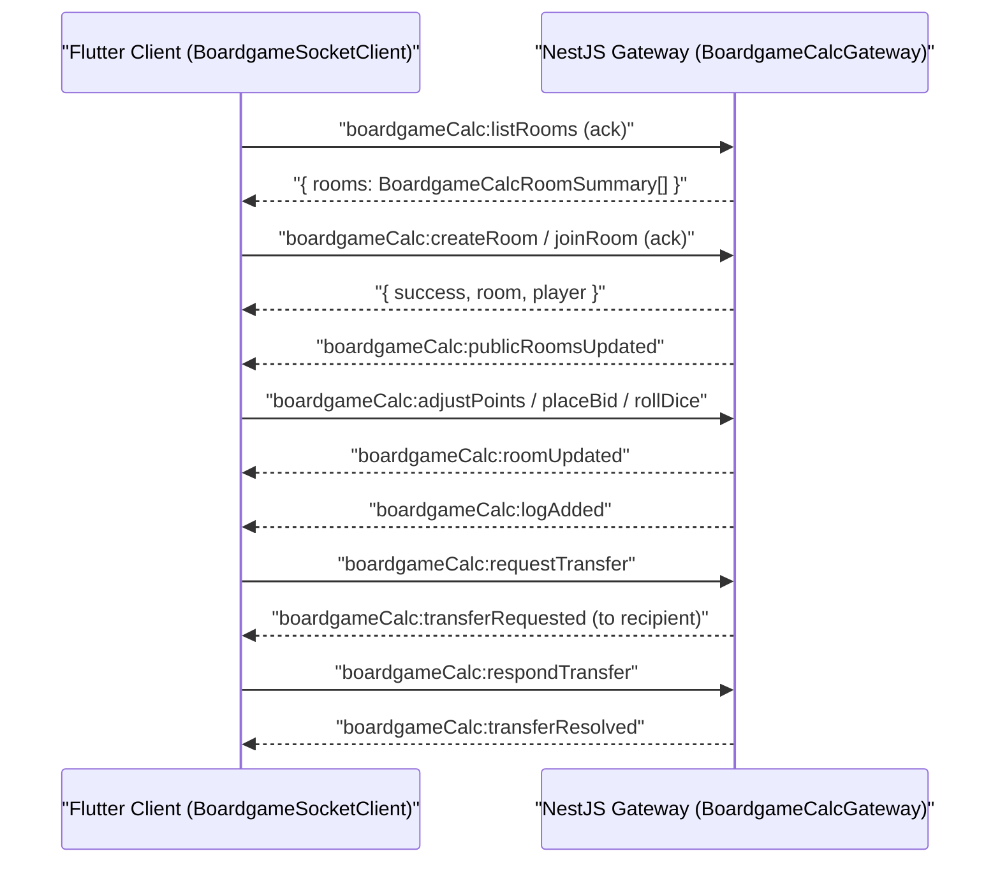

# Boardgame Calculator Socket.IO Protocol Reference

이 문서는 `pickban_smulator` NestJS 백엔드(`BoardgameCalcGateway`)와 Flutter `BoardgameSocketClient` 간 호환되는 Socket.IO 이벤트 규격을 정의합니다.

## 1. Sequence Overview

## 2. Client → Server Events

| Event | Payload Summary | Ack |
| :--- | :--- | :--- |
| `boardgameCalc:listRooms` | `{}` | `{ rooms: BoardgameCalcRoomSummary[] }` |
| `boardgameCalc:createRoom` | `{ nickname, title?, avatarColor?, avatarUrl?, settings?, sessionId? }` | `{ success, room?, player?, error? }` |
| `boardgameCalc:joinRoom` | `{ roomCode, nickname, avatarColor?, avatarUrl?, sessionId? }` | `{ success, room?, player?, error? }` |
| `boardgameCalc:leaveRoom` | `{ roomCode }` | Optional |
| `boardgameCalc:deleteRoom` | `{ roomCode }` | `{ success, error? }` |
| `boardgameCalc:adjustPoints` | `{ roomCode, targetPlayerId, delta, reason?, unitValue? }` | - |
| `boardgameCalc:adjustScore` | `{ roomCode, targetPlayerId, delta, reason?, unitValue? }` | - |
| `boardgameCalc:requestTransfer` | `{ roomCode, toPlayerId, amount, memo? }` | `{ success?, error? }` |
| `boardgameCalc:respondTransfer` | `{ roomCode, requestId, accept }` | - |
| `boardgameCalc:startAuction` | `{ roomCode, title?, minIncrement?, timeLimit? }` | - |
| `boardgameCalc:placeBid` | `{ roomCode, bidAmount, expectedHighestBid? }` | `{ success, error?, isConflict? }` |
| `boardgameCalc:designateAuctionWinner` | `{ roomCode, winnerId?, potAction, expectedHighestBid? }` | `{ success, error?, isConflict? }` |
| `boardgameCalc:resetAuction` | `{ roomCode }` | - |
| `boardgameCalc:placeBet` | `{ roomCode, amount }` | - |
| `boardgameCalc:resolveBettingWinner` | `{ roomCode, winnerId?, action }` | - |
| `boardgameCalc:resetBettingPot` | `{ roomCode }` | - |
| `boardgameCalc:updateSettings` | `{ roomCode, settings }` | - |
| `boardgameCalc:resetPoints` | `{ roomCode, customAmount? }` | - |
| `boardgameCalc:resetScores` | `{ roomCode, customScore? }` | - |
| `boardgameCalc:renamePlayer` | `{ roomCode, targetPlayerId, newNickname }` | `{ success, error? }` |
| `boardgameCalc:updateColor` | `{ roomCode, avatarColor, targetPlayerId? }` | - |
| `boardgameCalc:setCenterTool` | `{ roomCode, tool }` | `{ success?, error? }` |
| `boardgameCalc:rollDice` | `{ roomCode, count, sides }` | `{ success, dice?, error? }` |
| `boardgameCalc:secretNote:start` | `{ roomCode, timeLimit?, title?, autoReveal? }` | `{ success, error? }` |
| `boardgameCalc:secretNote:update` | `{ roomCode, content, isFolded? }` | `{ success, error? }` |
| `boardgameCalc:secretNote:lock` | `{ roomCode }` | `{ success, error? }` |
| `boardgameCalc:secretNote:reveal` | `{ roomCode }` | `{ success, error? }` |
| `boardgameCalc:secretNote:reset` | `{ roomCode, timeLimit?, title?, autoReveal? }` | `{ success, error? }` |

## 3. Server → Client Events

- `boardgameCalc:publicRoomsUpdated`: 공개방 목록 브로드캐스트
- `boardgameCalc:roomUpdated`: `{ room, me? }` — 방 상태 동기화 (비밀노트는 수신자별로 마스킹)
- `boardgameCalc:logAdded`: `{ log }` — 활동 로그 1건 추가
- `boardgameCalc:transferRequested`: `BoardgameCalcTransferRequest` — 송금 합의 요청 수신
- `boardgameCalc:transferResolved`: `{ accepted, amount, fromNickname, toNickname, fromPlayerId?, toPlayerId? }`
- `boardgameCalc:diceRolled`: `{ dice, rollerName, log? }`
- `boardgameCalc:roomDeleted`: `{ roomCode, reason? }`
- `boardgameCalc:error`: `{ message }`
